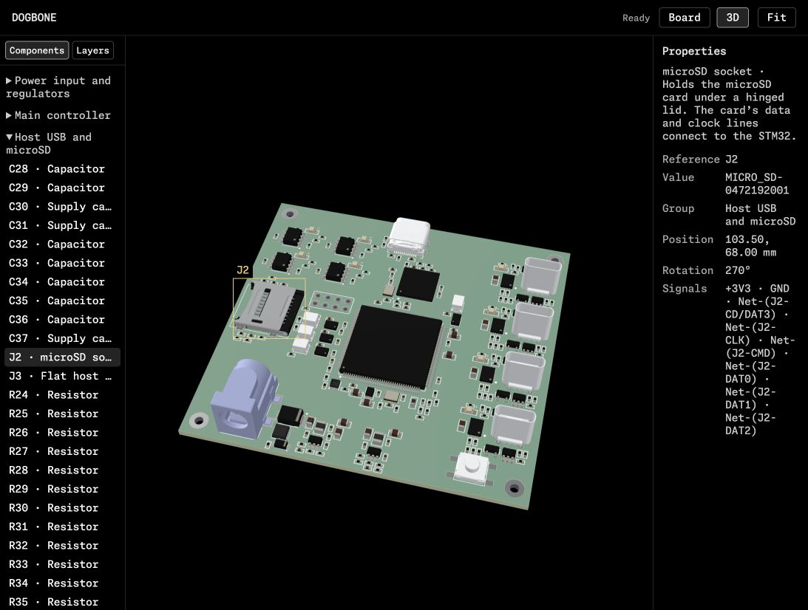

# dogbone

move parts in kicad with the agent you already use. watch in the browser.

<p>
  
  
</p>

python 3.10+. kicad 10 with the ipc api enabled.

```sh
git clone --recurse-submodules https://github.com/utkarshgill/dogbone.git
cd dogbone
python3 -m venv .venv
.venv/bin/pip install .
# open examples/pcbgolf/work/pcbgolf.kicad_pcb in kicad
.venv/bin/python -m dogbone --board examples/pcbgolf/work/pcbgolf.kicad_pcb
```

open [the viewer](http://localhost:4083/). add `http://127.0.0.1:4083/mcp` to your agent as a streamable http server.
