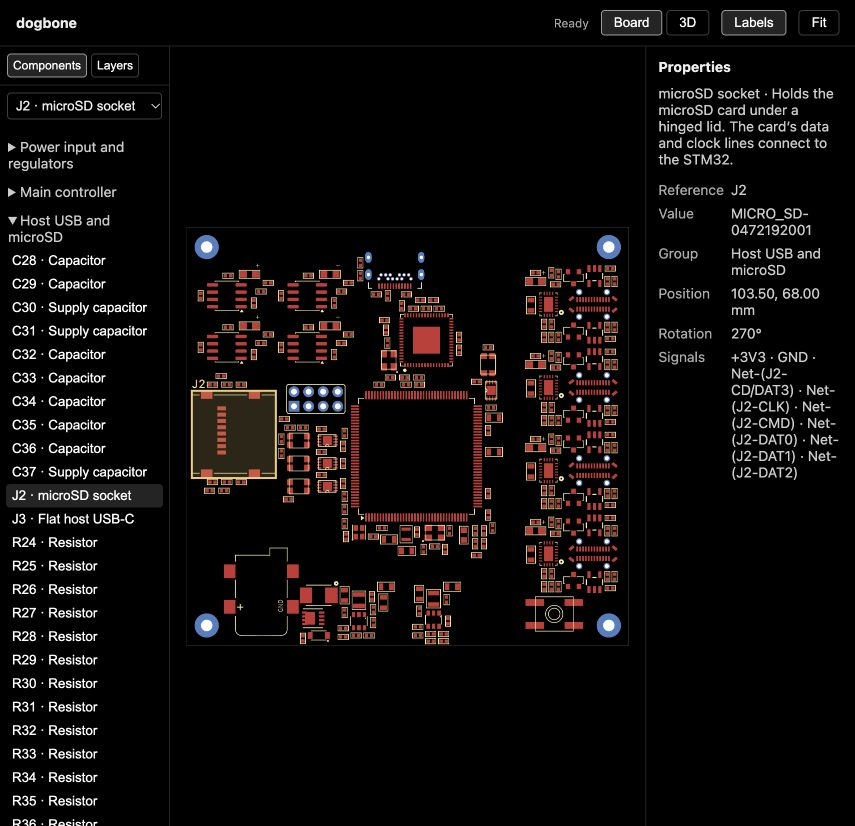

# DOGBONE

move parts in kicad from Codex or Claude Code. watch it happen in your browser.
dogbone runs on localhost. no dogbone signup.

<p>
  
  
</p>

Live move and undo

https://github.com/user-attachments/assets/76ac1100-9172-4a94-bd78-b0866c6c8f4a

python 3.10+. kicad 10 with the ipc api enabled.

```sh
git clone --recurse-submodules https://github.com/utkarshgill/dogbone.git
cd dogbone
python3 -m venv .venv
.venv/bin/pip install .
# open examples/pcbgolf/work/pcbgolf.kicad_pcb in kicad
.venv/bin/python -m dogbone --board examples/pcbgolf/work/pcbgolf.kicad_pcb --replay examples/pcbgolf/replay.json
```

open [the viewer](http://localhost:4083/). in another terminal, pick one.

```sh
codex mcp add dogbone --url http://127.0.0.1:4083/mcp
claude mcp add --transport http dogbone http://127.0.0.1:4083/mcp
```

start your agent in this folder. try `Move SW1 2 mm left with dogbone.` then `Undo it.`

Live moves glide in Board and 3D. Replay steps through four saved PCBGolf placements and exports a video from the same timeline. Replay leaves the open board alone.

PCBGolf placement replay

https://github.com/user-attachments/assets/e9076f35-e5fd-4971-a5a4-00738f61bf44
